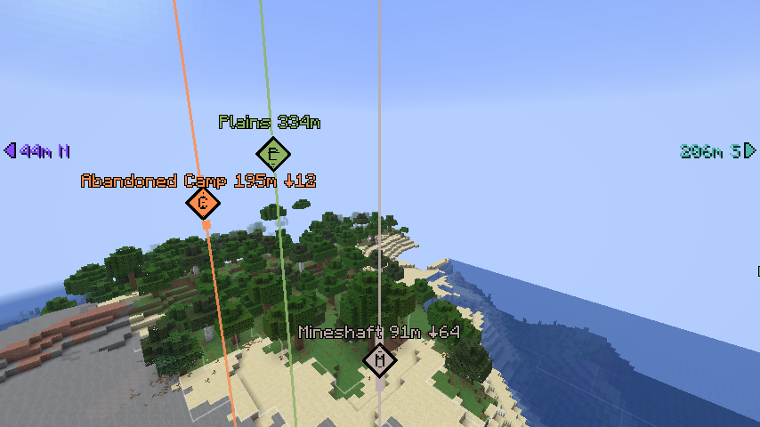
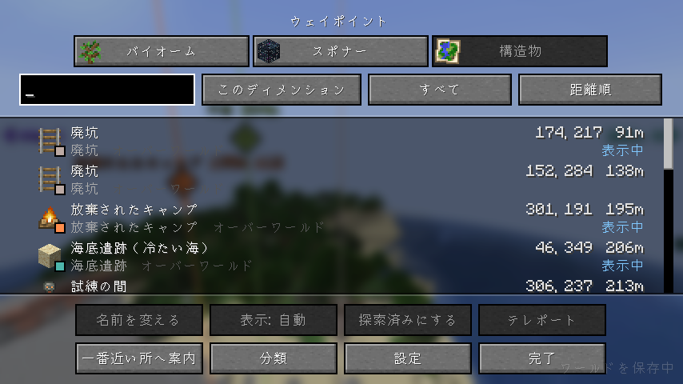
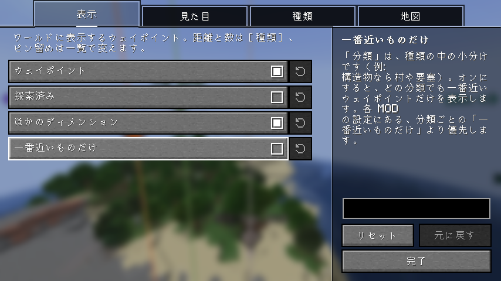

# Waypoints API

[English](README.md) | 日本語

ほかの MOD が見つけた場所を、ウェイポイントとして一覧・ワールドの中・地図の MOD に出す Fabric 向けクライアント MOD です。
クライアントに入れるだけで動作し、バニラサーバーでも使えます（サーバー側への導入は不要です）。

単体では何も表示しません。場所を探す MOD（構造物・バイオーム・スポナーなど）が、この MOD の API で場所を渡し、この MOD を自分の jar に入れて配ります。

## 機能

### ワールドの中

- **光の柱とひし形**: ウェイポイントごとに分類の色の光の柱を立て、場所の高さにひし形を描きます。ひし形には分類の頭文字を出せます。
- **ラベル**: 名前と距離、場所が上か下にどれだけ離れているかを出します。
- **矢印**: 見えていないウェイポイントは、画面の端に矢印と距離・方角を出します。
- **探索済み**: 着いた場所は探索済みになってトーストが出ます。探索済みは隠せます。
- **ほかのディメンション**: オーバーワールドのウェイポイントは、ネザーではつながる先の位置に出します（逆も同じ）。

### 一覧

MOD の種類ごとのタブで、1 つの一覧に並べます。検索・絞り込み・並び替えができます。

- 名前の変更、ピン留め（いつも表示）、表示しない、探索済みにする。
- 一番近い所への案内。
- テレポート（コマンドを使える人だけ）。
- 種類の中の分類ごとの表示・非表示。

### 地図の MOD

- [JourneyMap](https://modrinth.com/mod/journeymap): 全体地図に印として出します。
- [Xaero's World Map](https://modrinth.com/mod/xaeros-world-map)（Xaero's Minimap と一緒に）: ワールドマップに印として出します。
- 一覧から、JourneyMap・[Xaero's Minimap](https://modrinth.com/mod/xaeros-minimap)・[VoxelMap](https://modrinth.com/mod/voxelmap-updated) のウェイポイントに足せます。

### MOD を作る人へ

ほかの MOD は、エントリポイント `waypointsapi` で場所の種類を登録し、Loom の `include` でこの MOD を自分の jar に入れます。

## 設定

設定画面は [Mod Menu](https://modrinth.com/mod/modmenu) から開きます。すべての種類に共通する見た目を変えられます。種類ごとの距離・数・色は、その種類を足す MOD の設定で変えます。
キー（一覧を開く、ウェイポイントの表示の切り替え）は初期状態では割り当てがありません。操作設定の「Waypoints API」で割り当ててください。

## 必要なもの

- [Fabric API](https://modrinth.com/mod/fabric-api)
- [YetAnotherConfigLib](https://modrinth.com/mod/yacl)
- [Mod Menu](https://modrinth.com/mod/modmenu)（任意。設定画面を開くのに使います）

対応する Minecraft のバージョンは各リリースに記載しています。
