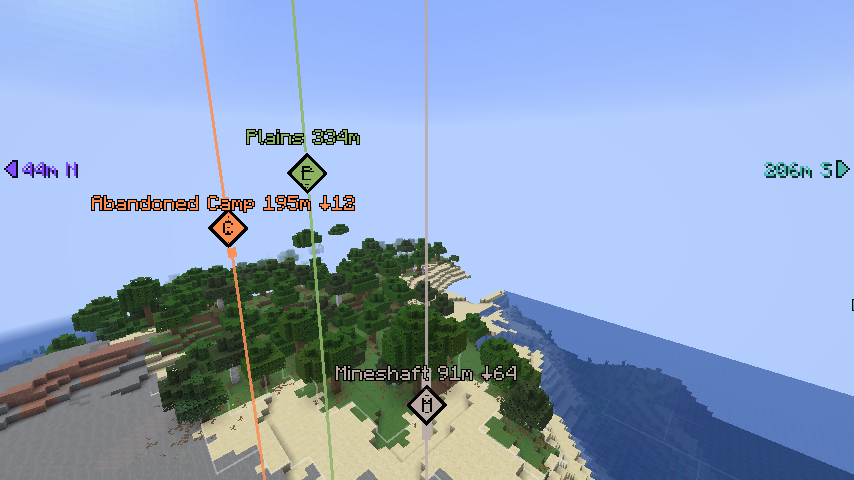
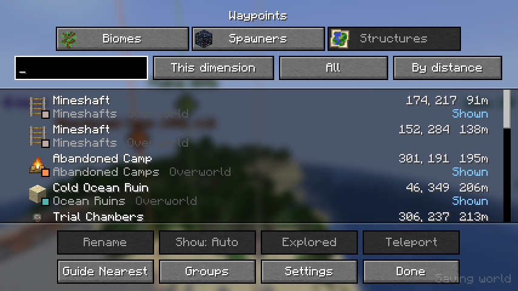
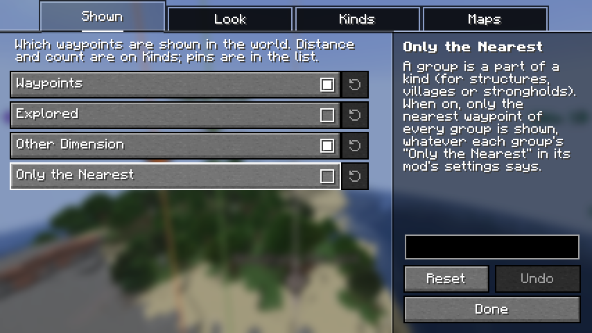

# Waypoints API

English | [日本語](README.ja.md)

A client-side Fabric mod that shows places other mods find as waypoints: in one list, in the world and on map mods.
Just install it on your client; it also works on vanilla servers (nothing needs to be installed on the server).

On its own it shows nothing: mods that find places (structures, biomes, spawners and the like) add them through its API, and ship it inside their own jar.

## Features

### In the world

- **Beams and diamonds**: each waypoint has a beam in its group's color, with a diamond where the place is. The diamond can show the group's initial.
- **Labels**: the name, the distance and how far above or below the place is.
- **Arrows**: the waypoints out of sight point from the screen's edges, with their distance and direction.
- **Explored**: a waypoint you reach is marked explored, with a toast, and can be hidden.
- **Other dimension**: the Overworld's waypoints are shown in the Nether where they would lead, and the other way round.

### The list

One list with a tab for each mod's kind of places, with search, filters and sorting.

- Rename, pin (always shown), hide, or mark a waypoint explored.
- Guide to the nearest waypoint.
- Teleport there, when you may run commands.
- Show or hide each group of a kind.

### Map mods

- [JourneyMap](https://modrinth.com/mod/journeymap): the waypoints are marks on the fullscreen map.
- [Xaero's World Map](https://modrinth.com/mod/xaeros-world-map) (with Xaero's Minimap): the waypoints are marks on the world map.
- A waypoint can be added from the list to the waypoints of JourneyMap, [Xaero's Minimap](https://modrinth.com/mod/xaeros-minimap) or [VoxelMap](https://modrinth.com/mod/voxelmap-updated).

### For mod developers

Other mods register their kinds of places through the `waypointsapi` entrypoint, and nest this mod in their jar with Loom's `include`.

## Settings

The settings screen is opened from [Mod Menu](https://modrinth.com/mod/modmenu). It has the look shared by every kind; the distance, count and colors of each kind are on the settings of the mod that adds it.
Keys (open the list, show/hide waypoints) are unbound at first. Bind them under "Waypoints API" in the Controls settings.

## Requirements

- [Fabric API](https://modrinth.com/mod/fabric-api)
- [YetAnotherConfigLib](https://modrinth.com/mod/yacl)
- [Mod Menu](https://modrinth.com/mod/modmenu) (optional, for opening the settings screen)

The supported Minecraft versions are listed on each release.
